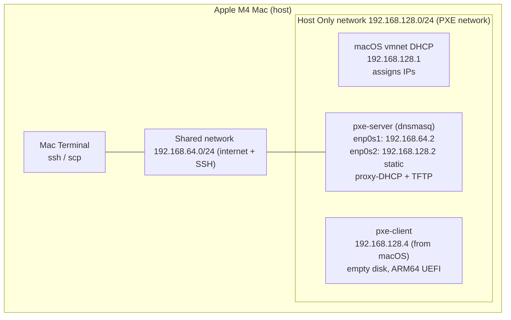
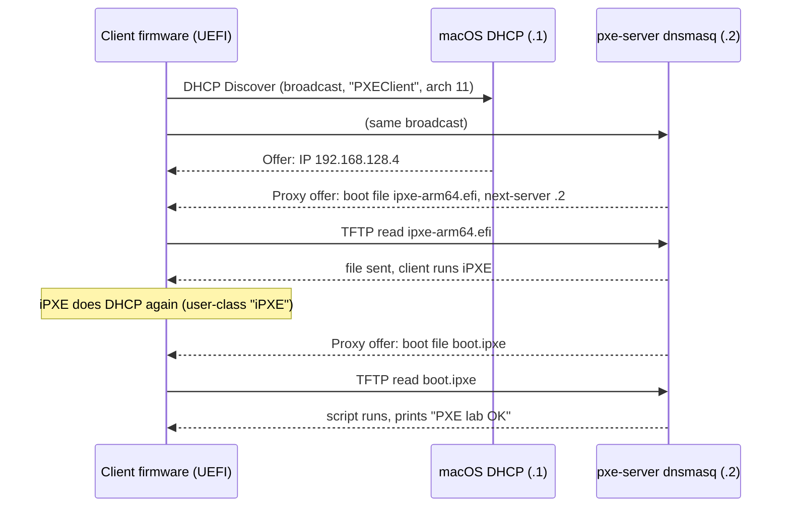

# PXE Lab: Network Booting a Bare ARM64 Machine

A home lab that boots a VM with an **empty disk** entirely over the network, using **dnsmasq** (proxy-DHCP + TFTP) and **iPXE**. It reproduces, at small scale, the first stage of the bare-metal provisioning pipelines used on data center rack integration and test lines (L10/L11).

**Result:** an ARM64 UEFI client with no OS powered on, got its IP from the existing DHCP server, got its boot instructions from my PXE server, downloaded iPXE over TFTP, then fetched and ran a boot script.

```
PXE lab OK: got 192.168.128.4 from 192.168.128.1
iPXE> _
```


---

## Why this matters

In a data center, new servers arrive with blank disks. Nobody installs them by hand. Each server's firmware boots from the network (PXE), loads a small bootloader, and then pulls a diagnostic OS or installer from a provisioning server. This lab builds and debugs that first link: **power on → DHCP → TFTP → iPXE → script**.

---

## Environment

| Component | Details |
| --- | --- |
| Host | Apple M4 Mac, 16 GB RAM |
| Hypervisor | UTM (QEMU backend, not Apple Virtualization) |
| PXE server | Ubuntu Server 26.04.1 LTS ARM64, 4 GB RAM, 2 vCPU, 20 GB disk |
| PXE client | Empty VM, ARM64 UEFI, 2 GB RAM, 2 vCPU, 8 GB empty disk, no ISO |
| Software | dnsmasq 2.92 (proxy-DHCP + TFTP), iPXE ARM64 EFI build |

### Network topology



The server has two adapters: **Shared** for internet and SSH, **Host Only** for PXE. The client is on Host Only only, so its DHCP broadcasts reach the server.

---

## Boot flow



Key ideas:

- **DHCP (DORA):** a machine with no OS has no IP, so it broadcasts. Client and server must share one Layer-2 network.
- **Proxy-DHCP:** another server (macOS here) already assigns IPs, so dnsmasq only adds boot information instead of competing.
- **TFTP:** a minimal UDP protocol small enough for NIC firmware. Used only for the first file.
- **iPXE chainloading:** iPXE is a full network bootloader. From here it could pull large files over HTTP.
- **Architecture matching:** the client reports its architecture in DHCP option 93 (11 = ARM64 UEFI). The server must send a matching binary.

---

## Repository layout

```
pxe-lab/
├── README.md
├── configs/
│   ├── pxe.conf          # /etc/dnsmasq.d/pxe.conf
│   └── 99-pxe.yaml       # /etc/netplan/99-pxe.yaml
├── tftp/
│   └── boot.ipxe         # /srv/tftp/boot.ipxe
├── logs/
│   └── dnsmasq-boot.log  # one full successful boot
└── screenshots/
    └── client-pxe-success.png
```

The iPXE binary is not committed. Download it from the iPXE project (see setup step 5).

---

## Setup

### 1. Create the server VM (UTM)

- Virtualize → Linux. **Leave "Use Apple Virtualization" unchecked**: that mode has no Host Only networking.
- Boot ISO: `ubuntu-26.04.1-live-server-arm64.iso` (the standard build, not the 64k-page build).
- Network 1: **Shared Network**. Network 2: **Host Only**.
- During install: enable **OpenSSH server**. After install, clear the ISO from the CD/DVD drive.

### 2. Connect over SSH

```bash
ssh <user>@192.168.64.2
ip a    # enp0s1 = Shared, enp0s2 = Host Only
```

### 3. Install packages

```bash
sudo apt update && sudo apt install -y dnsmasq tcpdump
```

dnsmasq fails to start at this point. That's expected (see Troubleshooting #3).

### 4. Give the PXE adapter a static IP

[`configs/99-pxe.yaml`](configs/99-pxe.yaml):

```yaml
network:
  version: 2
  ethernets:
    enp0s2:
      dhcp4: false
      addresses: [192.168.128.2/24]
```

```bash
sudo cp 99-pxe.yaml /etc/netplan/ && sudo chmod 600 /etc/netplan/99-pxe.yaml
sudo netplan apply
```

### 5. Configure dnsmasq and the TFTP root

[`configs/pxe.conf`](configs/pxe.conf):

```ini
port=0                                    # disable DNS (port 53 conflict)
interface=enp0s2                          # serve the PXE network only
bind-interfaces
dhcp-range=192.168.128.0,proxy            # proxy-DHCP: macOS assigns IPs
log-dhcp
enable-tftp
tftp-root=/srv/tftp
dhcp-userclass=set:ipxe,iPXE              # tag clients already running iPXE
pxe-service=tag:!ipxe,ARM64_EFI,"iPXE ARM64",ipxe-arm64.efi   # round 1: firmware
dhcp-boot=tag:ipxe,boot.ipxe              # round 2: iPXE gets a script (no loop)
```

```bash
sudo cp pxe.conf /etc/dnsmasq.d/pxe.conf
sudo mkdir -p /srv/tftp
sudo wget -O /srv/tftp/ipxe-arm64.efi https://boot.ipxe.org/arm64-efi/ipxe.efi
file /srv/tftp/ipxe-arm64.efi             # expect: EFI application, Aarch64
sudo cp boot.ipxe /srv/tftp/
dnsmasq --test
sudo systemctl restart dnsmasq
systemctl status dnsmasq --no-pager       # expect: active (running)
```

[`tftp/boot.ipxe`](tftp/boot.ipxe):

```
#!ipxe
echo
echo ========================================
echo   PXE lab OK: got ${net0/ip} from ${next-server}
echo ========================================
shell
```

### 6. Create the client VM and boot it

- Virtualize → **Other**, boot device **None**, **UEFI Boot checked**.
- Network: **Host Only only**.
- On the server, watch in two terminals:

```bash
sudo journalctl -u dnsmasq -f
sudo tcpdump -ni enp0s2 port 67 or port 68 or port 69 or port 4011
```

- Start the client. If it lands in the UEFI Shell: `exit` → Boot Manager → **UEFI PXEv4**.

---

## Annotated boot log

From [`logs/dnsmasq-boot.log`](logs/dnsmasq-boot.log):

```
option: 60 vendor-class 50:58:45:43:6c:69:65:6e:74   # hex for "PXEClient"
tftp: error 8 User aborted the transfer               # normal: UEFI checks file size first
tftp: sent /srv/tftp/ipxe-arm64.efi to 192.168.128.4  # iPXE delivered
tftp: file /srv/tftp/autoexec.ipxe not found          # normal: optional script
dhcp: vendor class: PXEClient / user class: iPXE      # iPXE asking again
dhcp: tags: ipxe, enp0s2                              # loop-prevention rule matched
dhcp: bootfile name: boot.ipxe / next server: 192.168.128.2
tftp: sent /srv/tftp/boot.ipxe to 192.168.128.4       # script delivered
```

---

## Troubleshooting: problems I actually hit

| # | Symptom | Cause | Fix |
| --- | --- | --- | --- |
| 1 | Couldn't paste commands into the UTM VM window | The VM console passes keystrokes only, no clipboard | Worked over SSH from Mac Terminal instead |
| 2 | "Please remove the installation medium" after install | ISO still mounted; firmware could boot the installer again | UTM → CD/DVD → Clear, then Enter |
| 3 | dnsmasq "Failed to start" right after `apt install` | dnsmasq also runs DNS by default; port 53 is held by `systemd-resolved` | `port=0` in the config. Log now shows "DNS disabled" |
| 4 | Host Only adapter already had a `dynamic` IP | macOS runs its own DHCP server on UTM's Host Only network, a **competing DHCP server** | Pinned the server's IP with netplan; switched dnsmasq to **proxy-DHCP** so macOS keeps assigning IPs |
| 5 | Client dropped straight to the **UEFI Shell**; no new dnsmasq log lines | Firmware didn't attempt network boot, so no request left the client | `exit` → Boot Manager → **UEFI PXEv4**, while watching `journalctl -f` and `tcpdump` |
| 6 | Success line said "from 192.168.128.1", not .2 | Not a bug: `${next-server}` reads the main DHCP answer (macOS). Boot files did come from .2 (`tftp://192.168.128.2/boot.ipxe ... ok`) | Use `${proxydhcp/next-server}` to display the proxy server |

**Messages that look like errors but are normal:**
- `resolvconf: Failed to set DNS configuration`: harmless, since DNS is disabled.
- `TFTP error 8 User aborted the transfer`: UEFI requests the file size, aborts, then downloads.
- `autoexec.ipxe not found`: iPXE checks for this optional script first.

**General debugging approach:** check both sides. The dnsmasq log shows what the server *decided*; `tcpdump` shows what actually *arrived*. No packets at all means the problem is on the client or network side (boot order, network boot disabled, wrong network, Secure Boot).

---

## How this maps to a real data center

| This lab | Data center equivalent |
| --- | --- |
| Host Only network | Isolated provisioning VLAN |
| Shared network + SSH | Management network |
| pxe-server (dnsmasq) | Provisioning server (in-house, MAAS, Ironic, etc.) |
| macOS DHCP + proxy-DHCP | Network team's DHCP + PXE proxy |
| Choosing PXEv4 in Boot Manager | BMC boot override via Redfish/IPMI, scripted for every node |
| `boot.ipxe` prints a message | `boot.ipxe` loads a RAM-based diagnostic OS or an installer |
| Client MAC in the log | MAC ↔ serial number tracked in MES |

---

## Next steps

- [ ] Add an HTTP server and load kernel/initrd over HTTP
- [ ] iPXE menu: diagnostic Linux vs. OS install
- [ ] Ubuntu autoinstall for fully unattended installation
- [ ] Collect `lshw` / `dmidecode` from the client back to the server
- [ ] Add x86-64 and legacy BIOS entries using DHCP option 93 matching